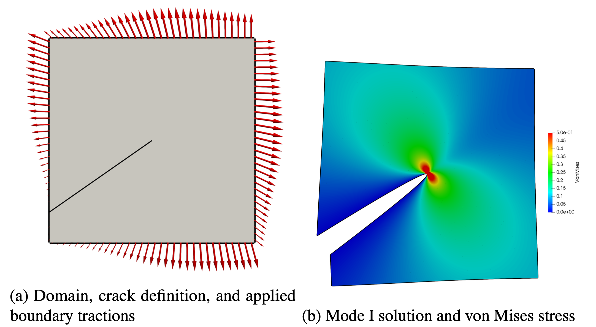

**2D Edge Crack Solved with pFEM-GFEM**
**\[Sanchez-Rivadeneira & Duarte, 2019\]**

**Inclined Edge Crack, Section 6.4 of \[Sanchez-Rivadeneira & Duarte,
2019\]**

1\) Go to folder

*2d\_cracks/2d\_edge\_cr**ack/pfem-gfem*

If you are unable to run ISET on your computer, go to the folder
*output\_files* and skip to Step 6\).

2\) Create a folder named 2026\_CEE598\_Test\_1 and copy these files into
it

*pfem\_33x33.tcl*  
*square\_2d\_domain\_tria\_33x33.grf*

Go to this folder in a terminal window.

3\) Check the definition of the crack

a\) Open the file *square\_2d\_domain\_tria\_33x33.grf* in a text editor.

**Modify, if needed,** section \"BEGIN NODES NUMBERED\" of file
*square\_2d\_domain\_tria\_33x33.grf*

\# Used for horizontal crack, Section 4.1 of paper 
\# 100000001 9 8 

\# Used for inclined crack, Section 6.4 of paper  
100000001  9  8.6982233047

b\) Open the file *pfem\_33x33.tcl* in a text editor.

**Modify, if needed,** the file *pfem\_33x33.tcl*

\# create a crack manager:  
\#   
\# Inclined edge crack problem, Section 6.4 of paper.  
\# Must also set in section \"BEGIN NODES NUMBERED\" of
*square\_2d\_domain\_tria\_33x33.grf*  
\# 100000001 9 8.6982233047

crackMgr2D crackMgrID 1 create straightCrackEndPoints tail 0.0 2.414213562 \\    tip 8.0 8.0

4\) Solve the problem using iset-docker. Run this command in the
terminal window

*iset-docker pfem\_33x33.tcl \> pfem\_33x33\_out.txt*

6\) Use Paraview (http://www.paraview.org) to open (you can just drop it on ParaView)

*pfem\_33x33.vtu*

a)  Show integration elements  
b)  Visualize the Solution field, component Y.  
c)  Identify nodes snapped to the crack line (check vertex nodes near
    the crack tail).

7\) Plot the deformed configuration; Zoom in at the crack tip and
explain the apparent spurious discontinuity.

8\) Plot von Mises stress:

Re-scale  
Set Range to max = 0.3

9\) Visualize the element-wise error in the energy norm: Field

TrueErrorElemEnergyNorm  
TrueRelErrorElemEnergyNorm 


10\) Visualize field Solution, Y-component, again: Keep this ON as we
visualize enrichments

11\) Use Paraview (http://www.paraview.org) to open *gfem\_33x33\_GFEM.vtu*
(you can just drop it on ParaView)

*pfem\_33x33\_GFEM.vtu*

**Visualize nodal enrichment (keep Solution field Y on, not the GFEM
mesh)**

a\) BranchFnEnrich : Use red spheres with Radius = 0.5, Scale factor \~=
0.3

b\) StepFnEnrich : Use blue spheres with Radius = 0.5, Scale factor \~=
0.2

c\) BranchStepPairEnrich : Use yellow spheres with Radius = 0.5, Scale
factor \~= 0.2

**Check where each enrichment is used: Element vertices and edges.**

**Optional: Save ParaView State (.pvsm)**

11a) If you got lost in the previous Task:

**Close ParaView and open it again.**

Load ParaView State (you can just drop it on ParaView):

*pfem-gfem\_enrichments\_state\_2026.pvsm*

**Select "Search files under specified directory"**

Visualize enrichments, etc.

12\) Open the file pfem\_33x33\_out.txt using a text editor

a)  Check the number of branch and step functions created:

CrackManager2D::createBranchFunctions

Number of CompNods enriched with Branch Fn (Including those with
BranchStep Pair) = **52**

CrackManager2D::createBranchFunctions

Number of CompNods enriched with BranchStepPair Fn = **4**

**Compare the last one with what we saw in ParaView**

CrackManager2D::createCrackStepFunctions

Number of CompNods enriched with Step Fn = **77**

**Check the problem size:**

Num Equations = 9348 Num Non Zeros = 122182

**Check the number of positive eigenvalues**

MumpsSolver\<T\>::factorize():  

Number of negative pivots = 0  
Number of positive eigenvalues = 9348  
Dimension of matrix = 9348  

**Check the convergence of Babuska's algorithm**

SymSolver\<T\>::solve: Stabilization being used:

Iteration: 0 rel\_err =  
\[2.155196802334206e-24\]  
rel\_err\_norm = 2.155196802334206e-24 tolerance mrhs = 1e-12

**Strain Energy and Error in the Energy Norm**

energy:  
\[3.792933697716725\]  
energy\_exact\_sol:  
\[3.793036132949721\]

\|\|u - u_p\|\|\_E = 1.4313296824726039e-02

\|\|u - u_p\|\|\_E / \|\|u\|\|\_E = 5.1967424033667322e-03

13\) **Open the Tcl File**

Study the Tcl commands.

Details are in iset\_reference\_manual.pdf

**OPTIONAL:**

**Make changes to the Tcl file,**

Run the code again and reload files in ParaView

Check the changes in the data printed to the screen after modifications,
such as problem size and the error of the pFEM-GFEM solution.

1\) **Turn off**

parSet useBranchHeavisideFnPairWithGeomEnrich off

2\) **Turn off geometrical enrichment (i.e., use Topological
enrichment)**

\# crackMgr2D crackMgrID 1 branchFnGeometricEnrich inCylinder radius 2

**[Change Problem: Move crack tail to same as in Section 4 of
paper]{.mark}: Edge crack \[(0.0), (0,8)\]**

Repeat the steps followed for the inclined crack.
